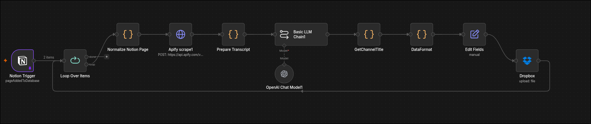
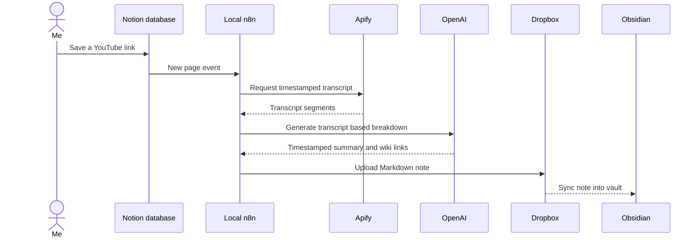
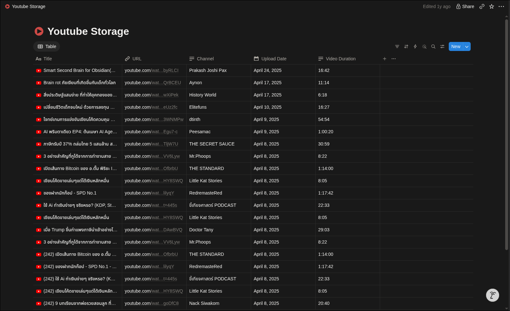
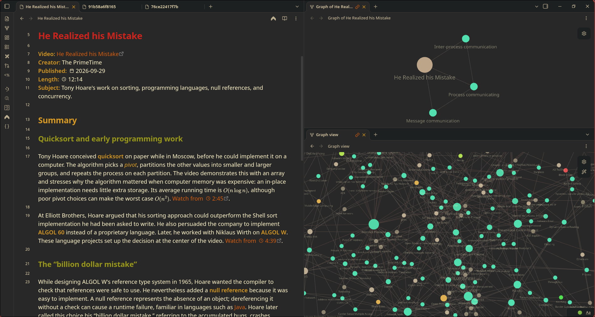

# YouTube Summarizer

**Keep the ideas. Skip the clickbait.**

  
  
  
  
  
  

## What it is

A local n8n workflow that watches a Notion database for saved YouTube videos, retrieves timestamped transcripts through Apify, and uses an OpenAI model to prepare structured Markdown notes. Dropbox syncs the notes into an Obsidian vault, where inline wiki links connect ideas across videos.

## Why I built it

I often find useful ideas in videos wrapped in clickbait framing. I wanted the substance without spending time on delivery designed to provoke a reaction. This workflow gives me a readable breakdown that I can revisit and build on in Obsidian.

## How it works

The workflow handles videos one at a time. It prepares the transcript with timestamps, asks the model to omit sponsorships and calls to action, then adds video metadata and an embed to the note.

## Example

The Notion table is the video queue:

The generated note presents a timestamped summary with metadata and inline links to related concepts:

## Tech stack

- **Workflow:** n8n running locally
- **Video queue:** Notion
- **Transcript retrieval:** Apify YouTube transcript actor
- **Summary generation:** OpenAI Chat Model
- **Note delivery:** Dropbox sync
- **Knowledge base:** Obsidian

## Import the workflow

The sanitized n8n export is [`workflow/youtube-summarizer.json`](workflow/youtube-summarizer.json). There is no hosted demo because the workflow runs on my local n8n instance and uses my connected services.

1. Import the JSON into your n8n instance.
2. Select your Notion database and connect a Notion account.
3. Add your Apify, OpenAI, and Dropbox credentials.
4. Set the Dropbox destination to a folder synced with your Obsidian vault.
5. Review the output mapping and provider costs before activating the workflow.

The export does not include credentials, pinned records, personal database identifiers, or instance metadata. It uses `/Obsidian/YoutubeNote/` as its Dropbox destination path.

> **Export limitation:** The supplied JSON's final `Edit Fields` node does not include the LLM response in its `Output` field. Connect the model text output there before importing it for use. The screenshots show the result from the working workflow; the export snapshot does not reproduce that output without this mapping.

## Design choices

- **Transcript grounded:** the model is told to use the transcript as its source and not invent timestamps or claims.
- **Useful content first:** sponsorships, self promotion, and calls to action are excluded from the breakdown.
- **Local workflow:** n8n runs on my own host; the connected providers handle transcript retrieval, language processing, and file sync.
- **Notes that connect:** relevant concepts use Obsidian wiki links so the ideas can connect with the rest of the vault.

## Requirements

An n8n instance, a Notion database with YouTube links, Apify access, an OpenAI account, and a Dropbox folder synced with an Obsidian vault. Transcript retrieval depends on captions being available for each video. Review provider pricing and limits before use.
